# CircuitScope

Automatic RC/RLC filter classifier
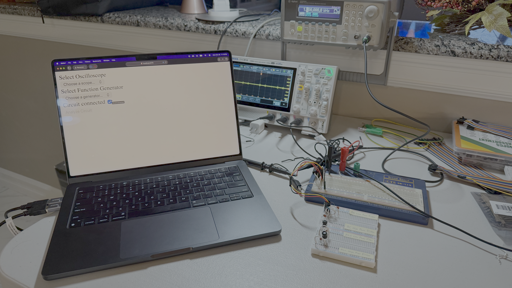

## The Circuits

The function generator sends voltage signals (square waves) through the blue and red ports in the back.  The red-yellow-black connector plugs into any one of four circuits: the RC Low Pass, RC High Pass, RLC Low Pass, and RLC High Pass filters.

 
The input and output voltage are measured by probes connecting to the oscilloscope, which can accurately measure voltage data at the nanosecond scale.

 
The computer program connects to the function generator and oscilloscope.  It sends commands through them to setup each instrument.  This tells the function generator to send square wave into the connected filter.  The output is measured by the oscilloscope and read by the computer.

 
I created an algorithm that sets the scale of the oscilloscope using a trial-and-error test: zoom in and measure until the last 10% of data stops averaging zero.

 
The finished project would then perform a data regression of the data onto each of my mathematically derived models.  Using linear algebra to decipher multidimensional errors, the program would identify the correct model and estimate the component values.

 
Unfortunately, my function generator (at least 25 years old) broke down before I could finish my work.  Now it cannot output waves, so my oscilloscope cannot read the output.

 

### The state of the project right before my function generator broke

After turning on my lab instruments, plugging them into my computer, and connecting one of the filters, I could click the "Analyze Circuit" button on the web interface. This caused the function generator to send square wave signals into the filter. The output was measured by the oscilloscope, which entered my auto-scaling algorithm. Once the scale was set, the computer read the oscilloscope data. It used a Python library (SciPy) to fit the data to each of my derived models. The program could choose the right model for a few of the filters, and I was still working on it when my function generator completely stopped working. Overall, the project was still a great success in teaching me electrical engineering, and no hour went to waste.

 
Also see the conclusion in the lab notes.

## Lab Notes

These notes document my derivations for models representing RLC systems.

## CircuitScope Notes

### Front Page (Schematics)

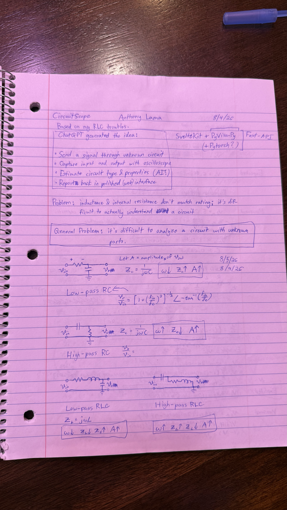
The first page defines the problem of generalizing a system to analyze multiple circuits and begins modeling RC/RLC circuits with transfer functions.

### Calculus-Heavy Derivation (Wrong)

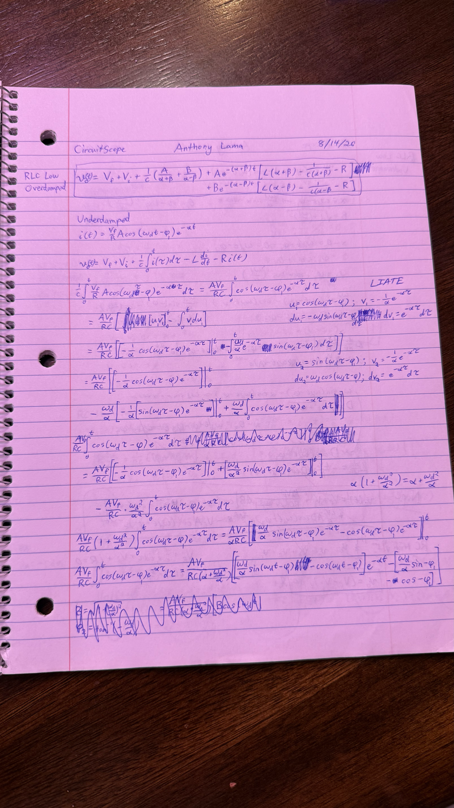
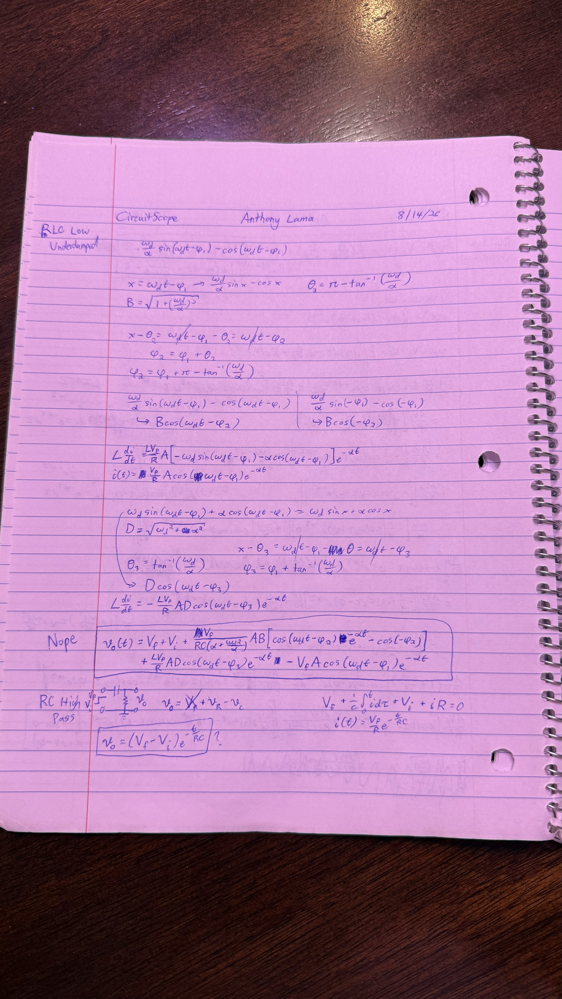
These two pages show how misunderstanding a basic physics law (Kirchhoff) can lead to pouring hours into the wrong derivation.

<!-- ### Transfer Functions Example

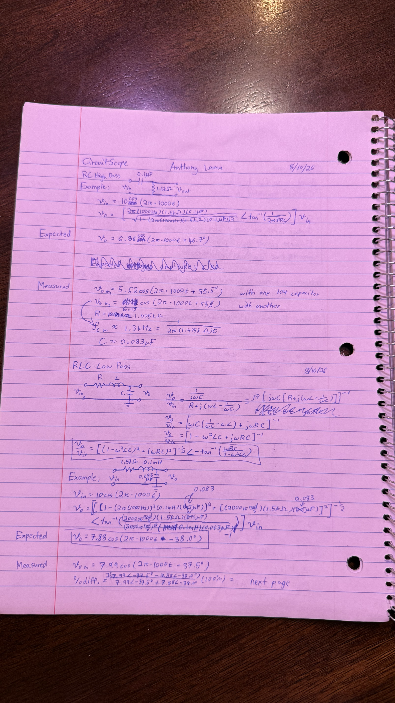
Here I experiment with transfer functions.

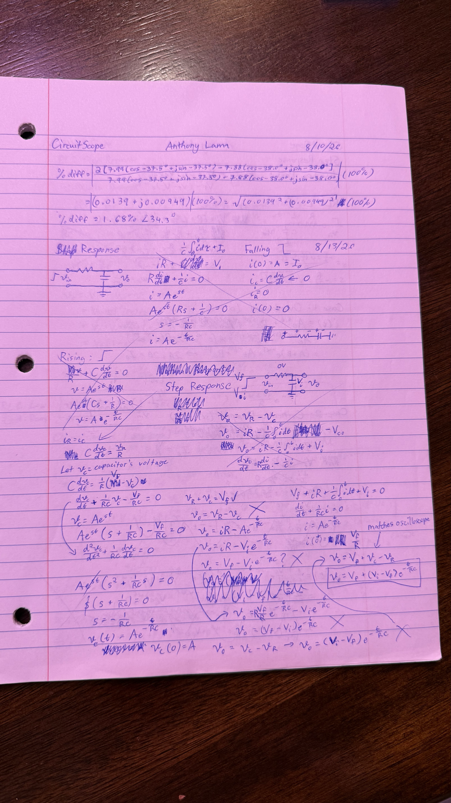 -->

### Mathematical Findings

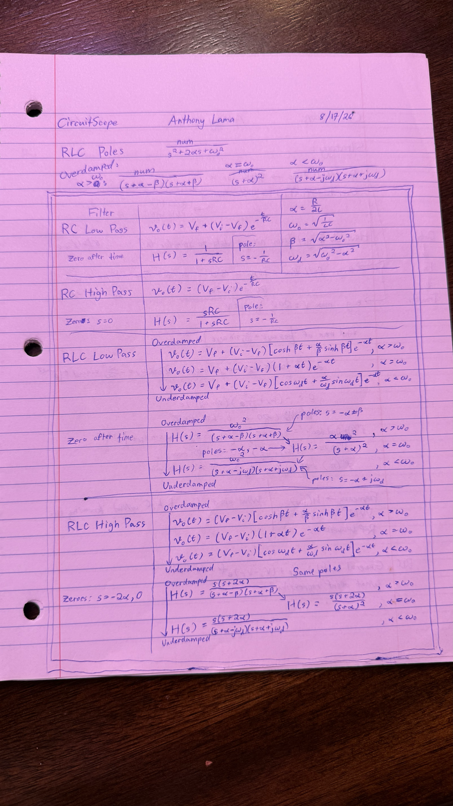
After fifteen pages of work, I created this table aggregating the equations I derived.  The v_o(t) equations describe the step response of every filter, while the H(s) equations describe their transfer functions.

### Conclusion

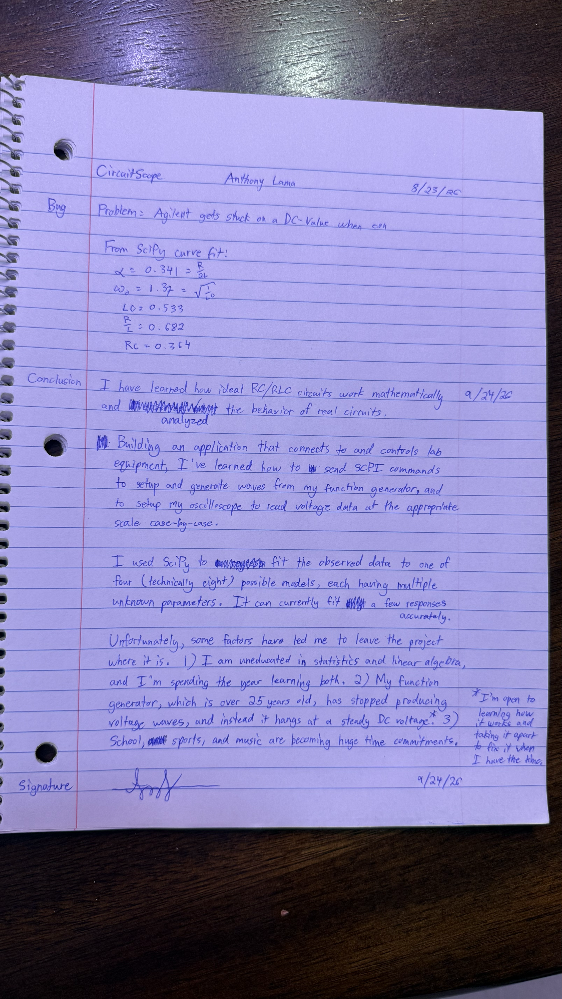
The top of the page shows a potential set of component values calculated by the computer regression.

 
The conclusion describes what I learned, what I created, and why I stopped.

## First RLC Oscillator Circuit Notes

### Front Page (Schematics & Measurements)

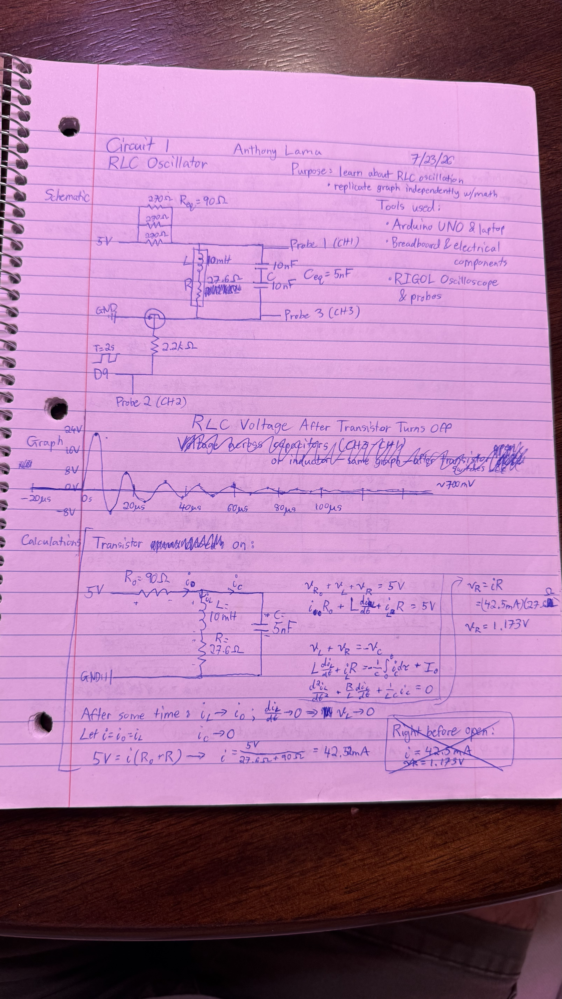
The first page shows a schematic of my circuit setup, along with my oscilloscope-measured data.

### Derived Voltage (V) vs Time (s) Model

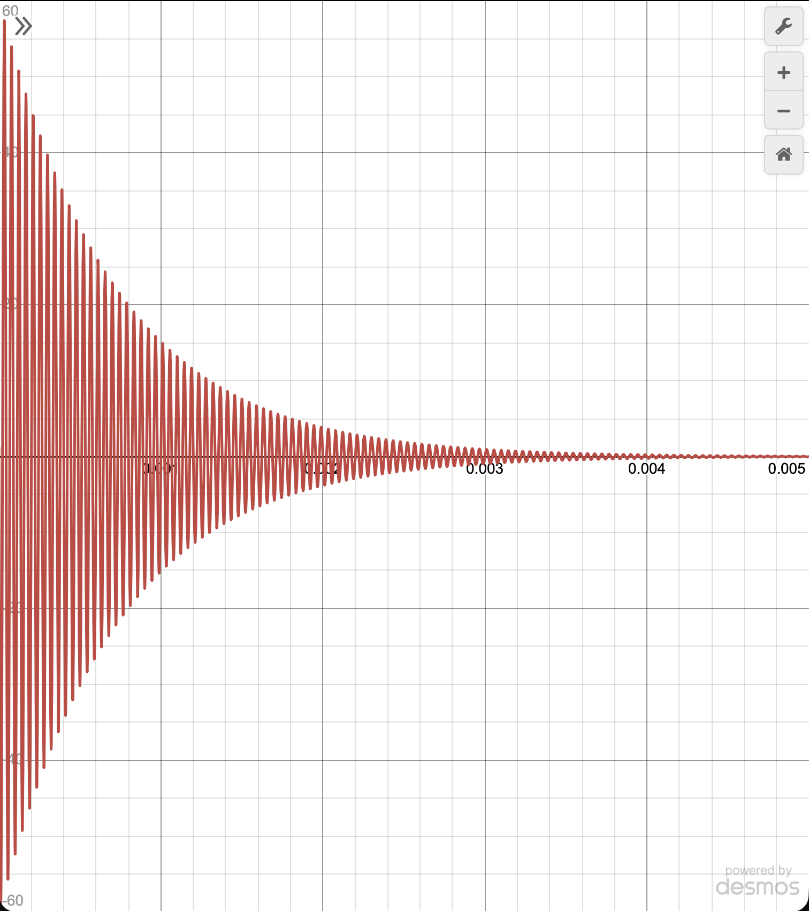
The equation I derived predicted too many oscillations.

### Conclusion

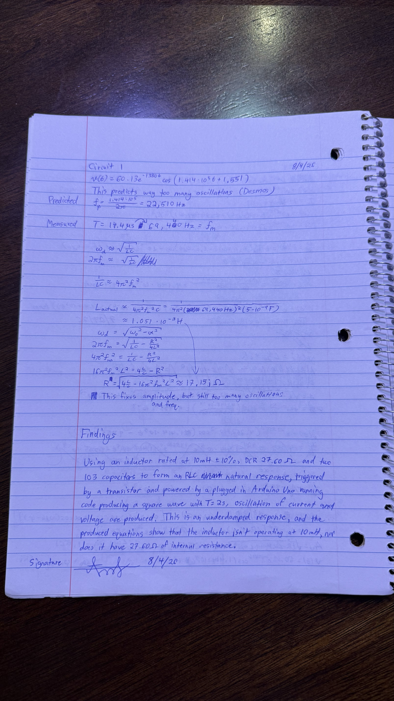
Here I conclude that the inductor is not operating at its labelled component values, but I only had a rough understanding of what could have been going on.

 

Find the full set of notes [here](lab-notes/)!
