# Lab Notes

### circuitscope-01

### circuitscope-02-transfer1

### circuitscope-03-transfer2

### circuitscope-04

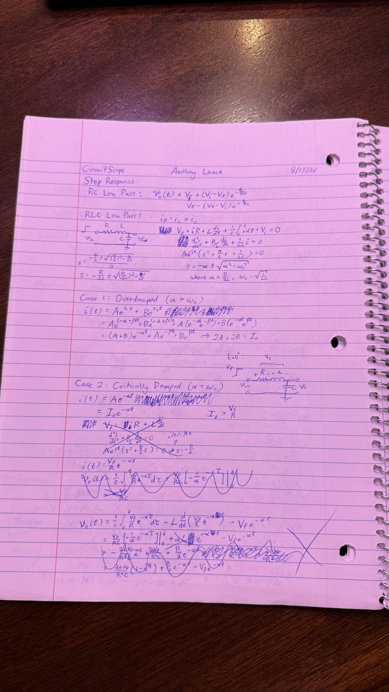

### circuitscope-05

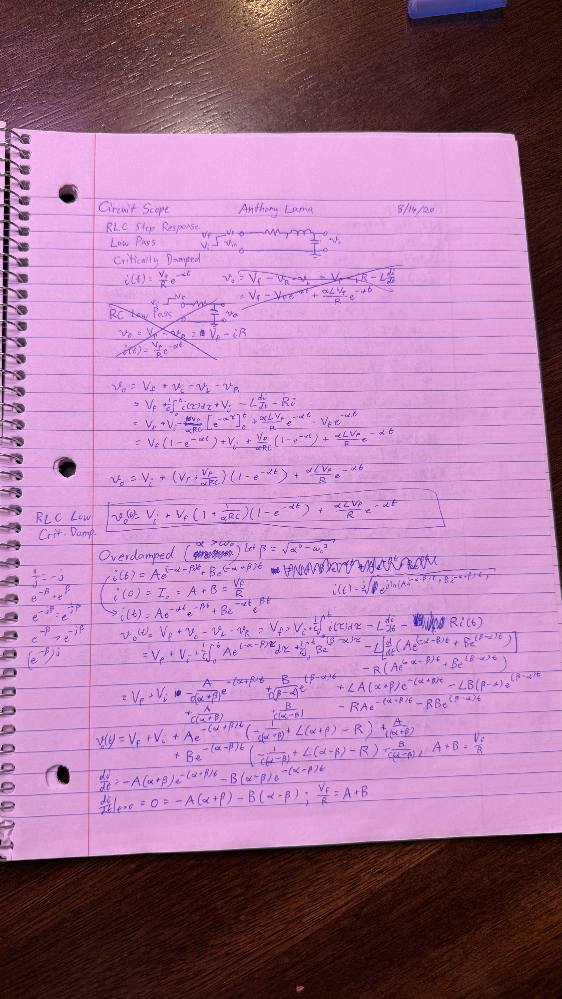

### circuitscope-06

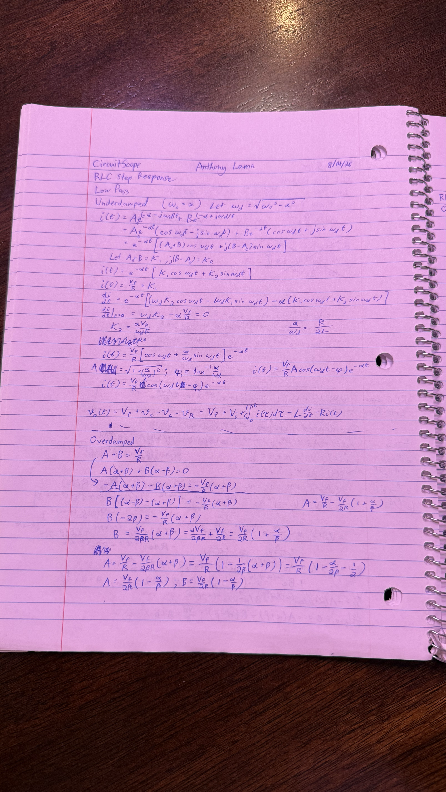

### circuitscope-07-fail1

### circuitscope-08-fail2

### circuitscope-09

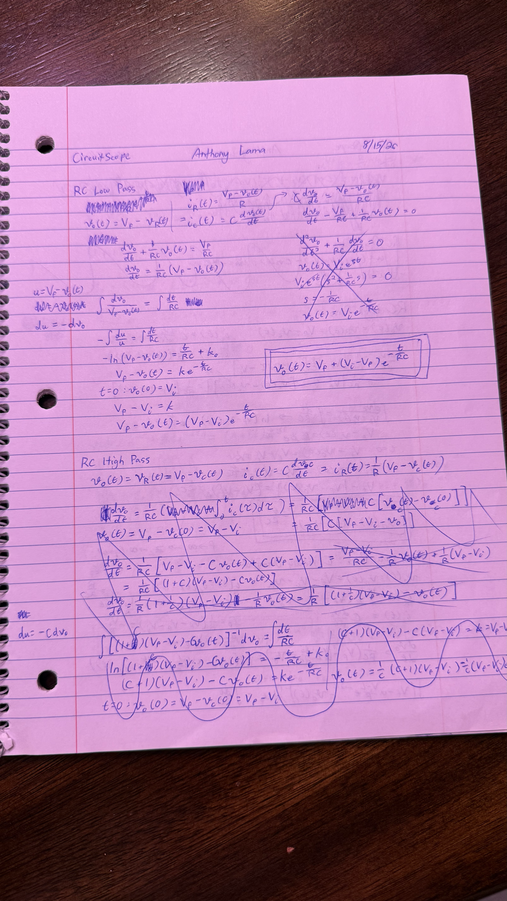

### circuitscope-10

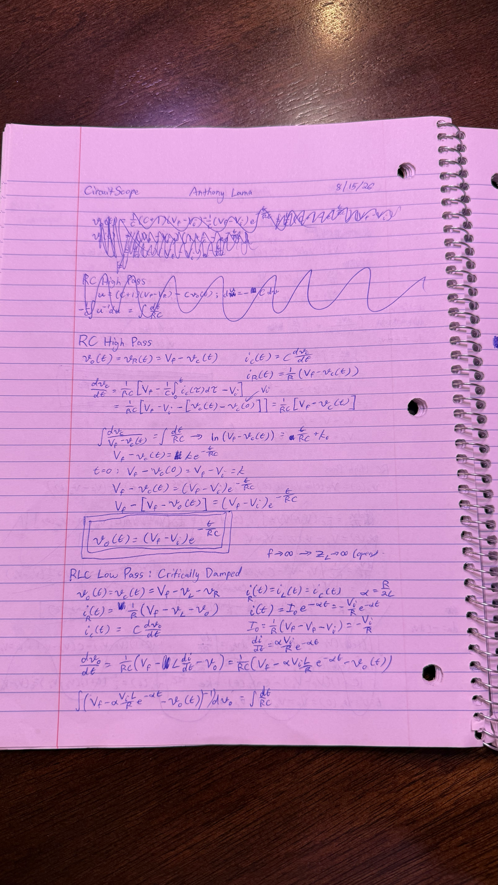

### circuitscope-11

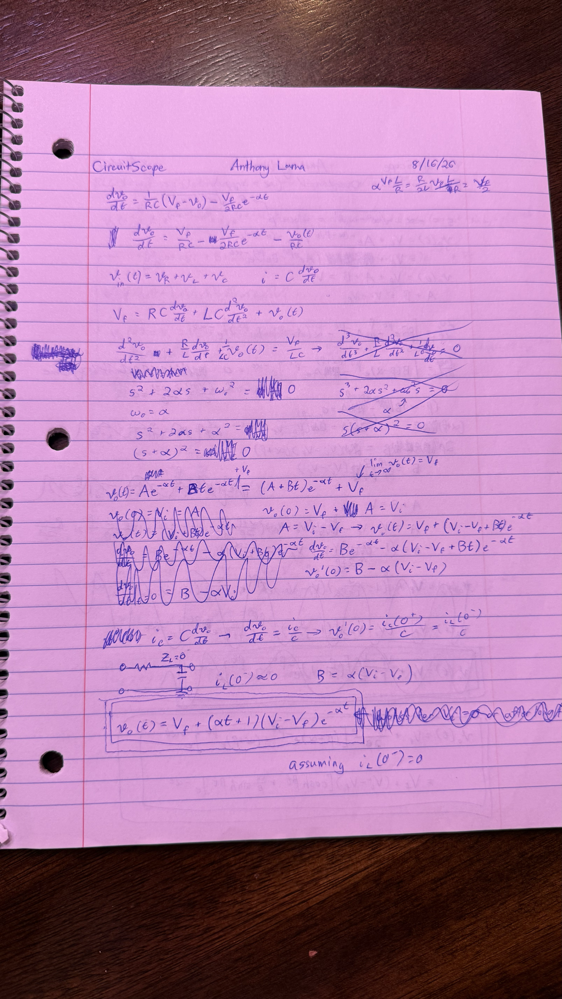

### circuitscope-12

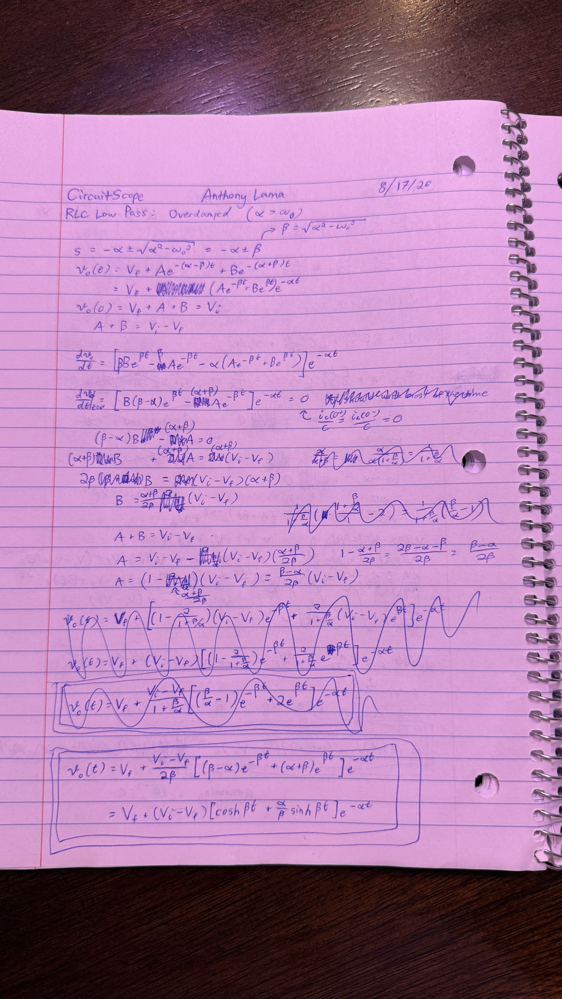

### circuitscope-13

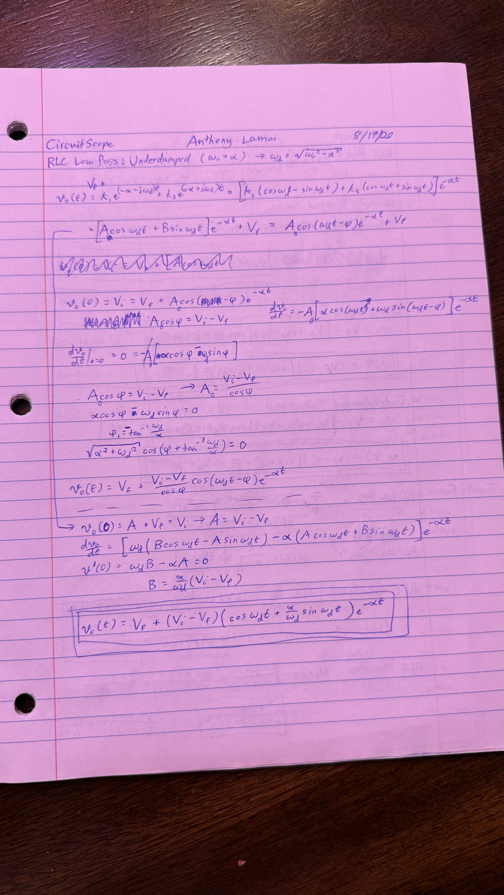

### circuitscope-14

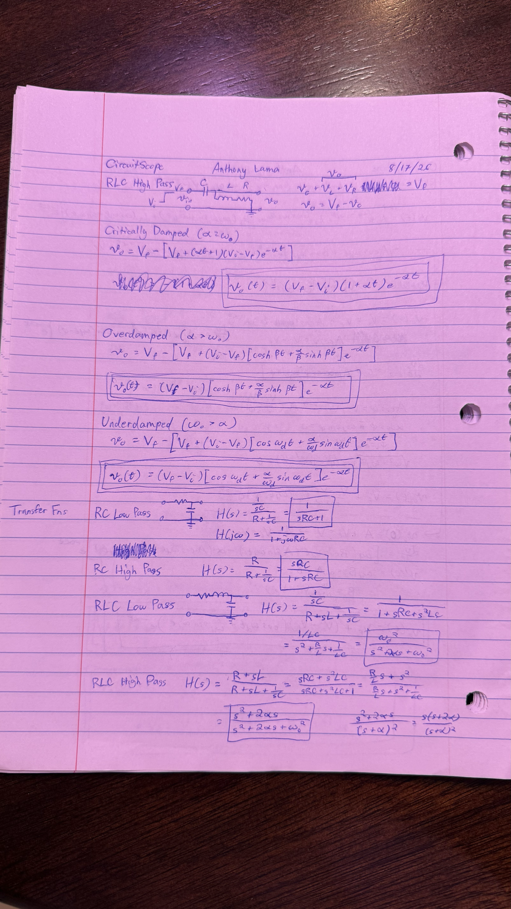

### circuitscope-15-findings

### circuitscope-16

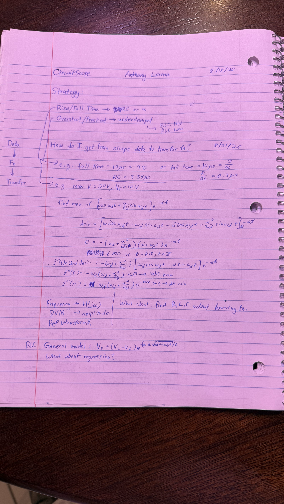

### circuitscope-17-conclusion

### rlc-oscillator-01

### rlc-oscillator-02

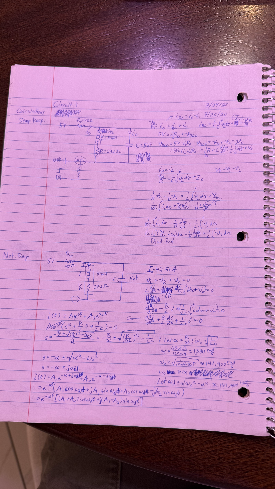

### rlc-oscillator-03

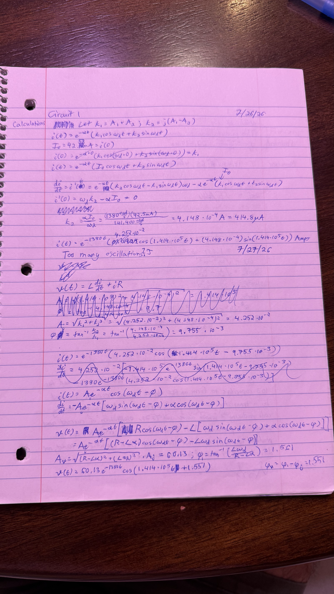

### rlc-oscillator-04-discrepancy

### rlc-oscillator-desmos

